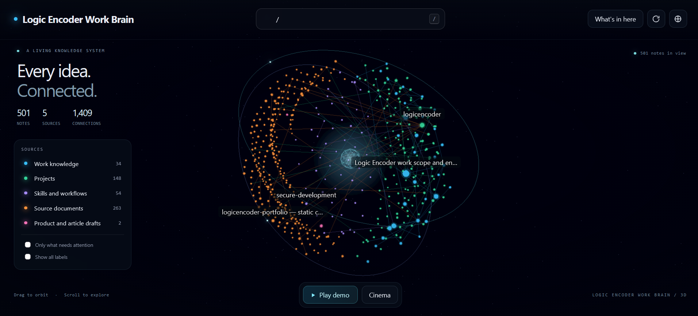

# Logic Encoder Work Brain

Years of project notes, source documents, skills and decisions are useless when nobody can find them or relate one to another. Logic Encoder Work Brain is a personal knowledge system that turns a body of work into a searchable wiki and an explorable 3D graph, and lets an AI assistant answer questions from a small, reviewed packet of that knowledge instead of guessing. It serves one operator who builds and maintains many applications and wants every method, project fact and decision kept in one place that both a person and an assistant can read.

## Tech stack

| Layer | Technologies |
|---|---|
| Knowledge store | Markdown wiki and immutable source files tracked in Git |
| Tooling | Python command-line tools for validation, search, ingestion and audits |
| 3D graph | Node.js server with a prebuilt WebGL renderer |
| Workspace | A Python web workspace for search, review and model questions |
| Model access | OpenRouter, OpenAI and Anthropic APIs with keys held only in the running session |

## The 3D graph

Every note becomes a point and every link between notes a line. Colours separate work knowledge, project pages, skills and workflows, source documents and drafts, and the counters show how many notes, sources and connections the graph holds. A visitor drags to orbit, scrolls to zoom, clicks a note to read it and presses the slash key to search. A demo grows the graph through its real connections in about half a minute, a cinema mode hides the surrounding controls, and a filter limits the view to notes that need attention.

## A wiki with sources

Original documents stay unchanged as sources, and the assistant writes synthesis pages that cite them, record contradictions and keep a dated history of every accepted change. A content index lists every page, and checks refuse a page that lacks a source or links to a page that does not exist. Retrieval ranks pages by words and relations, so a question about a project, a method or a past decision returns the pages that carry the evidence.

## Asking with a reviewed packet

The workspace searches the knowledge, assembles the matching passages into a packet and shows it for review before anything leaves the machine. Only after the operator confirms does the packet go to the chosen model together with the question, and the answer cites the notes it used. Packets can also be exported as Markdown for use in an ordinary chat.

## Skills and libraries

Reusable working methods are kept as skills: short instructions with checklists for building software, writing articles, reviewing code, securing changes, documenting products and working with the operator's servers. Optional skill packs are switched on when a task needs them, and an automatic choice suggests the few skills that fit a task. Markdown that the operator imports from other tools is previewed, accepted explicitly and stored without overwriting existing skills.

## Control panel and upkeep

A control panel shows the health of the wiki, freshness of pages, retrieval quality, evaluation results of the skills and the state of the services the brain runs as. Scheduled-style maintenance is run by hand on purpose: validation, dependency reports, backups with a tested restore and blind measurements of whether a skill actually improves an answer.

## Scope and limits

The brain holds work material only and excludes private messages, credentials and customer records. Its graph and read-only preview are available inside the operator's own network, and the model workspace needs an unlock token and the operator's own provider key.

---

Private code: [second-brain](https://github.com/logicencoder/second-brain)

See [REPOS.md](REPOS.md) for related repositories.

**[Logic Encoder](https://logicencoder.com)** · [GitHub](https://github.com/logicencoder) · [Contact](https://logicencoder.com/contact/)
